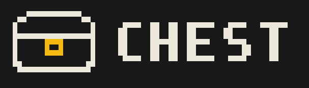

# CHEST

<center>

</center>

> **Give CHEST a folder, tell it how you want the files organized, and CHEST puts them into the right compartments.**

CHEST is a file organization, indexing, and automation CLI tool built in Go, inspired by the Minecraft chest. It focuses on deterministic sorting, reversible operations, fast searching, and an extensible architecture.

---

## Installation

### Option 1: Go Install
```bash
go install github.com/Aswanidev-vs/chest/cmd/chest@latest
```
Ensure your Go bin path (`$GOPATH/bin` or `%USERPROFILE%\go\bin`) is included in your system `PATH`.

### Option 2: Shell Script (Linux & macOS)
```bash
curl -sSL https://raw.githubusercontent.com/Aswanidev-vs/chest/main/install.sh | bash
```

### Option 3: PowerShell (Windows)
```powershell
irm https://raw.githubusercontent.com/Aswanidev-vs/chest/main/install.ps1 | iex
```

### Option 4: Build from Source
```bash
git clone https://github.com/Aswanidev-vs/chest.git
cd chest
make build
```

---

## Core Features

- **Concurrent Search Engine**: Built using `fastwalk` for parallel directory traversal and `fzf/src/algo` for exact and fuzzy scoring. Supports filtering by file category, extension, size, modification date, and in-file content grep.
- **Rule-Based Organization**: Sort by extensions, categories, file size boundaries, and date. `--date` defaults to modification-year folders, while `--date-source auto` can use embedded photo/video dates when available; finer granularities name their month folders (`2025/Jan/`) unless `--month-format number` is passed. `--date-source filename` mines dates from filenames (`IMG_20230115_...`, `WhatsApp Image 2024-05-01...`, `report_20250126.pdf`). Define custom rules on the CLI or use built-in presets (`downloads`, `media`, `documents`, `developer`, `photos`). Rules persist in `chest.toml` — drop one in a project folder (or `~/.chest/chest.toml` for user-wide defaults) and CHEST picks it up; precedence is flags > `--rule` > project `chest.toml` > user `chest.toml` > preset. Rule conditions can also match embedded metadata: `camera=Canon`, `artist="Daft Punk"`, `codec=h264`, or `meta.<key>=` for anything else the extractors surface. Validate any set with `chest rule check`.
- **Signature-Based Format Detection & Metadata Extraction**: Every file is inspected by content signature (magic bytes first, extension as fallback) to determine its true format, then enriched with embedded metadata — EXIF `DateTimeOriginal`/`CreateDate`, QuickTime `mvhd` creation time, PDF Info dictionary fields, and ID3 / Vorbis / RIFF-INFO audio tags, plus ZIP-based OOXML / ODF / EPUB core properties. The extractor registry is open, so custom binary formats can be registered programmatically (CHEST ships with a built-in custom-format example: `.gocut` GoCut project files, detected by JSON signature or extension, exposing `format=gocut`, MIME `application/x-gocut-project`, category `video`, and an embedded `createdAt` as the taken date) and then routed with `format=...` rules even when the extension is unknown or renamed.
- **Safety First**:
  - Full dry-run preview (`chest sort --dry-run` or `-n`) before files move, including a **CONFLICTS block** whenever two files resolve to the same destination. By default the second file is auto-renamed (`photo (1).jpg`) — case-normalized, so `Photo.jpg` and `photo.jpg` never silently destroy each other; pass `--collision skip` to leave the second file in place instead.
  - Interactive confirmations.
  - Built-in collision policies: `skip`, `rename`, `replace`, or `abort`.
  - Comprehensive operation logging and rollbacks via `chest undo`. Runs where some files failed are recorded honestly as `Partial`/`Failed` (never `Complete`), `undo` validates the whole batch before moving anything and rolls back cleanly if interrupted.
- **Folder Watch Automation**: Monitor directories continuously with `chest watch`. New files are picked up via filesystem events (`fsnotify`) and sorted automatically with debounce safeguards. Use `--initial` to sort what's already in the folder before watching, and get instant terminal feedback when folders are created or removed. Plugin classifiers and `GetCustomRules()` apply here too, and each debounce window is recorded as one history entry — not one entry per file.
- **Interactive Rules Builder**: Design a rule set with `chest repl`. The directory is scanned once, then `add` / `edit` / `rm` refine the rules while `preview` re-plans from the current set on every keystroke and renders the same dry-run report as `sort --dry-run` — `preview` is strictly read-only, and only `apply` moves files (recorded in history, so `chest undo` reverts the run). Reusable rule sets live in `~/.chest/templates` as TOML, which keeps fields the rule-string syntax cannot express.
- **Local Indexing & Analysis**:
  - Incremental metadata and SHA256 hashing backed by pure-Go SQLite (`ncruces/go-sqlite3`).
  - Storage analytics with `chest stats`.
  - Exact duplicate file detection with `chest duplicates`.
  - Stale and zero-byte file reports with `chest analyze`, with a total run-time footer showing how long the command took to generate the report.
  - **Self-refreshing reports**: a scoped `stats`/`analyze` run re-indexes that folder each time, and a bare run re-populates an empty cache from the current directory (so `chest clean` never leaves you staring at all-zero reports). Re-indexing also **prunes** rows for files that were deleted/moved, or are now covered by `--except`.
  - Cache management with `chest index --clear` and `chest clean`.
  - **Machine-readable reports**: `--json` / `--csv` / `--out <file>` on `stats`, `duplicates`, `analyze` and `history`; `chest sort --dry-run --json` emits the full plan (operations, folders, conflicts) for scripting.
- **Shell Tab Completion**: One-liner setup with `chest completion --install` (auto-detects your shell from `$SHELL`). Tab-complete subcommands and flags in `bash`, `zsh`, and `fish`, or print/save the raw script with `chest completion <shell>`.
- **Parallel Performance & Live Feedback**:
  - Incremental indexing skips unchanged files (using `size + mtime`) so repeated runs are near-instant.
  - Hashing and directory traversal run in parallel across CPU cores (`errgroup` + `fastwalk`), and SQLite writes are batched in transactions.
  - Live in-place progress bars on the long-wait commands: `index`, `duplicates`, `analyze`, and `sort`.
- **Exclusion Flags (`--except`)**:
  - Available on `index`, `stats`, `analyze`, and `duplicates` to prune noisy directories or globs (e.g. `node_modules`, `venv`, `.git`) before traversal — excluded paths are also removed from any previously-indexed rows: `chest duplicates ~/Projects --except node_modules,venv,.git`.
  - Report freshness: a scoped `stats`/`analyze` auto-refreshes its folder each run, an empty cache is re-populated from the current directory automatically, and `--refresh` forces a re-scan with stale/excluded-row purge. Largest-file listings use absolute paths.
- **System Path Protection Guard**:
  - Automatic safeguards preventing modification to OS root volumes (`/`, `C:\`) and system paths (`C:\Windows`, `C:\Program Files`, `/etc`, `/usr`, `/var`, etc.).
  - Protected paths remain completely accessible for read-only commands (`search`, `stats`, `duplicates`, `analyze`, `index`).
  - Dangerous operations (`sort`, `watch`, `undo`) require explicit `--allow-system` override with confirmation.
- **Network Speed Testing**: Compare Ookla (nearest speedtest.net server) and Cloudflare (`speed.cloudflare.com`) results, with download and upload bars shown as `◆` filled and `◇` empty diamonds; select `--ookla` or `--cloudflare`, or use `--json` for machine-readable output. Add `--disk` to also benchmark local storage (sequential read/write MB/s + random 4K IOPS) on a private temp file — size it with `--disk-size` and target a directory with `--disk-path`.
- **Battery Monitoring**: `chest battery` reports charge, power draw, health, cycle count and drain rate using the platform's own reader on Windows, Linux and macOS — watch it live with `--realtime`, or record with `--record` into `~/.chest/battery.db`, a history database kept separate from the file index so `chest clean --all` cannot destroy it. A field the platform cannot supply is omitted rather than shown as zero, and anything derived rather than read — the drain rate, and per-application attribution via `--apps` — is labelled as an estimate.
- **Scheduled Organizing**: `chest schedule add --cron "0 2 * * *" --preset downloads ~/Downloads` runs sorts periodically without a foreground process — registered as a crontab entry on Linux/macOS, a scheduled task on Windows (daily cron expressions). Manage jobs with `chest schedule list` / `remove` / `run-now`, or use `--print-cron` to get the crontab line without installing anything.
- **Plan Artifacts**: `chest plan --out plan.json` saves the exact plan `sort` would execute **without touching a single file**, so it can be reviewed, committed or diffed. `chest plan apply plan.json` executes it after re-validating every source, refusing the whole batch if anything moved. `chest plan diff a.json b.json` compares two plans.
- **Checkpoints & Selective Undo**: `chest checkpoint --name before-cleanup` marks a point in history; `chest undo --to before-cleanup` then reverts everything after it as one atomic all-or-nothing batch. `chest undo <id> --file photo.jpg` reverts a single file and leaves the rest of the run undoable. `chest history --prune --keep <n>` bounds the log.
- **Backup Integrity (`manifest` / `verify`)**: `chest manifest` writes a reproducible SHA-256 inventory of a folder; `chest verify` re-hashes and reports `OK` / `MODIFIED` / `MISSING` / `ADDED`, exiting **4** on any drift so scripts can detect it. Both are read-only and never silently drop files that exceed `--max-size`.
- **Content-Aware Collision Handling**: `chest sort --hash-collisions` hashes **only the files involved in a collision** — never the whole tree — so a genuine duplicate is skipped while two different files that happened to share a name are both preserved and auto-renamed.
- **Near-Duplicate Image Detection**: `chest duplicates --similar` groups images that *look* alike using a perceptual hash (DCT-based, no external dependency), reported separately from exact SHA-256 matches, with a `--threshold` Hamming tolerance.
- **Batch Rename**: `chest rename --to "{year}-{month}-{day}.{ext}"` normalizes messy filenames in place using the same date machinery as `sort`, with dry-run, collision policy, history and full `undo`. It never moves a file between folders.
- **Health & Inspection**: `chest doctor` is a single read-only check over index freshness, un-undoable history entries, unreadable directories, broken symlinks, schedules and rule validity. `chest tree` draws a folder as a box-drawing tree with rolled-up sizes.
- **Rule Introspection**: `chest rule eval <file>` explains which rule matched a file, why, and where it would go — the behavioural counterpart to `rule check`, which only validates syntax.
- **Continuous Indexing & Trends**: `chest index --watch` keeps the local index warm as files change; `chest stats --trend` reports growth against recorded snapshots.
- **Plugin Architecture**: Extend classification and rule handling through independent external processes using `hashicorp/go-plugin` over standard RPC.

---

## Command Reference

| Command | Description | Example |
|---|---|---|
| `chest sort` | Sort files using presets, flags, or custom rules; `--date` groups by modification year by default, or embedded media date with `--date-source auto`, or filename dates with `--date-source filename`; `--date-granularity month|day` groups into named month folders (`2025/Jan/`), or `2025/01/` with `--month-format number`; `--format`/`format=` use content-detected format (`--allow-system` for OS dirs); `--hash-collisions` hashes **only the conflicting subset** so an identical copy is skipped and distinct content is auto-renamed instead of clobbered; `--dry-run --json` exports the plan; rules also load from `chest.toml` and match metadata fields | `chest sort ~/Downloads -d --date-granularity month` |
| `chest search` | Search files by name, metadata, or file content grep; `--csv`/`--out` export and `--save`/`--load` for named saved queries in `~/.chest/searches` | `chest search "report" -e pdf -c "invoice"`, `chest search --save recent-pdfs` |
| `chest repl` | Interactive rules builder with a live, read-only preview; `preview` re-plans from the current rules and never touches disk, only `apply` moves files (recorded in history, so `chest undo` reverts it). Intra-plan conflicts auto-rename and appear as a CONFLICTS block. Save reusable rule sets to `~/.chest/templates` | `chest repl ~/Downloads -p media` |
| `chest watch` | Continuously watch and organize incoming files (`--initial` sorts existing files first; `--allow-system` guard) | `chest watch ~/Downloads --preset media --initial` |
| `chest history` | View previous operations log (`--json`/`--csv`/`--out` export; partial runs marked `Partial`/`Failed`); `--prune --keep <n>` trims the oldest entries so the log cannot grow unbounded | `chest history` |
| `chest undo` | Revert the latest operation or a specific ID, auto-cleaning empty created directories; `--to <label>` reverts everything after a checkpoint as one atomic batch, `--file <name>` reverts only matching files | `chest undo`, `chest undo 3`, `chest undo --to before-cleanup`, `chest undo 3 --file photo.jpg` |
| `chest undo cache` | Inspect undo cache or wipe all history (`--clear`) | `chest undo cache --clear` |
| `chest index` | Index directory metadata into local SQLite (incremental, parallel; `--except` to skip, prunes deleted/excluded rows on re-index); `--watch` keeps the index warm continuously as files change | `chest index ~/Documents --hash`, `chest index ~/Downloads --watch` |
| `chest stats` | Display storage consumption and category breakdown; scoped runs auto-refresh, bare runs repopulate an empty cache, `--refresh` forces re-scan+purge, largest files shown with absolute paths; `--trend` with `--day`/`--week`/`--month` reports growth against a recorded snapshot; `--json`/`--csv`/`--out` export | `chest stats ~/Projects --refresh`, `chest stats . --trend --month` |
| `chest speedtest` | Compare Ookla vs Cloudflare download/upload/ping/jitter; transfer bars use `◆` filled and `◇` empty diamonds | `chest speedtest` (both), `chest speedtest --ookla`, `chest speedtest --cloudflare`, `chest speedtest --json`, `chest speedtest --disk` (adds storage benchmark; `--disk-size`, `--disk-path`) |
| `chest battery` | Report battery charge, power draw, health, cycle count and drain rate (aliases `power`, `batt`); `--realtime` redraws the reading in place until Ctrl+C, `--daemon` records in the foreground. Drain rate is derived from change in charge, so `--seconds` must span a window long enough to move the reading — short ones report `n/a` instead of a bogus rate; `--apps` attributes activity per application as an ESTIMATE apportioned from measured CPU and I/O, since no platform reports true per-app battery energy unprivileged, and draws a bar chart of it over the period. It needs a window to apportion over, so it goes with a period flag or `--seconds`; `--top` sizes that list. `--record` appends to `~/.chest/battery.db`, a database kept separate from the `index.db` so `chest clean --all` cannot destroy it (`chest clean --battery` clears it, opt-in), and works on a single reading too. `--day`/`--week`/`--month`/`--year` report those periods from history, cut in UTC. `--low` and `--fail-under` take `0`–`100`, where `0` disables. Cross-platform, with per-platform readers for Windows, Linux and macOS | `chest battery`, `chest battery --json`, `chest battery --realtime`, `chest battery --seconds 600`, `chest battery --record --daemon`, `chest battery --week --apps`, `chest battery --low 20` |
| `chest duplicates` | Locate duplicate files using content hashes (`--except` to skip dirs/globs; excluded rows are purged from the cache); `--json`/`--csv`/`--out` export | `chest duplicates ~/Downloads --except node_modules,venv` |
| `chest duplicates --similar` | Group **near-duplicate images** by perceptual hash (pHash), reported separately from exact SHA-256 matches; `--threshold <0-64>` sets the Hamming tolerance (default 10) | `chest duplicates ~/Pictures --similar --threshold 6` |
| `chest duplicates --quarantine` | **Opt-in** follow-up that moves duplicates into a staging folder after confirmation — never deletes, recorded in history so `chest undo` restores them | `chest duplicates ~/Downloads --quarantine ./Review -y` |
| `chest analyze` | Read-only audit of storage distribution and old files (`--except`/`--refresh` supported; scoped runs auto-refresh, bare runs repopulate an empty cache), with total run time in the report footer; `--json`/`--csv`/`--out` export | `chest analyze ~/Downloads --refresh` |
| `chest rule check` | Validate the rule set for a directory (flags, presets, `chest.toml`) without scanning — catches invalid sizes and unsupported field/operator combos | `chest rule check ~/Downloads -p media` |
| `chest rule eval` | **Explain** which rule matches a given file, why it matched and where it would go — read-only, the behavioural counterpart to `rule check` | `chest rule eval ~/Downloads/photo.jpg -p media` |
| `chest plan` | Save an organization plan as a JSON artifact **without moving anything** (`--out`), replay it (`chest plan apply`, recorded in history so `undo` reverts it), or compare two plans (`chest plan diff`) | `chest plan ~/Downloads -p media --out plan.json` |
| `chest rename` | Batch-rename files **in place** from a template (`{year}`, `{month}`, `{day}`, `{ext}`, `{date}`), with dry-run, collision policy, history and `undo`; never moves a file between folders | `chest rename ~/Pictures -r --to "IMG_{year}{month}{day}.{ext}" --date-source filename` |
| `chest checkpoint` | Mark the current history position with a named label, so later work can be reverted as one batch | `chest checkpoint --name before-cleanup` |
| `chest manifest` | Hash a folder into a reproducible SHA-256 inventory for backup verification; read-only, `--csv`, `--max-size` | `chest manifest ~/Documents --out manifest.json` |
| `chest verify` | Re-hash a folder against a manifest and report OK / MODIFIED / MISSING / ADDED; exits **4** when anything differs so scripts can detect drift | `chest verify ~/Documents --manifest manifest.json` |
| `chest doctor` | One read-only health check: index freshness vs. disk, un-undoable history entries, unreadable directories, broken symlinks, schedules and rule validity (`--strict` to fail) | `chest doctor --strict` |
| `chest tree` | Draw a folder as a box-drawing tree with rolled-up sizes and proportional bars; `--depth`, `--sort size\|name`, `--json` | `chest tree ~/Downloads --depth 2` |
| `chest schedule` | Periodic organizing via cron: `add --cron "0 2 * * *"`, `list`, `remove`, `run-now`; `--print-cron` shows the crontab line without installing | `chest schedule add --cron "0 2 * * *" -p downloads ~/Downloads` |
| `chest plugin` | Manage external plugins (`list`, `info`, `install`, `remove`) | `chest plugin list` |
| `chest clean` | Clear cached SQLite index with confirmation (`-y` to skip, `--all` for DB, `--history` to also wipe undo history, `--battery` to also delete recorded battery history — not implied by `--all`) | `chest clean -y` |
| `chest man` | Display detailed manual page with examples (like Linux man) | `chest man sort` |
| `chest preset` | List available built-in sorting presets | `chest preset` |
| `chest completion` | Install shell tab-completion for `bash`, `zsh`, `fish` (`--install` auto-detects `$SHELL`) | `chest completion --install` |
| `chest version` | Display version and build architecture | `chest version` |

---

## Building a Rule Set Interactively (`chest repl`)

`chest repl` is the loop for designing a rule set: the directory is scanned once, then you
add, refine and preview rules until the plan looks right, and only `apply` moves anything.

```bash
chest repl ~/Downloads
```

### 1. Build — start broad, check as you go

```text
chest> add type=Video -> Videos
added type=Video -> Videos
chest> add type=Image -> Images
added type=Image -> Images
chest> list
2 rule(s):
   1. type=Video -> Videos
   2. type=Image -> Images
chest> preview
CHEST PLAN
────────────────────────

bigvideo.mp4
  FROM: bigvideo.mp4
  TO:   Videos/bigvideo.mp4
  WHY:  type = Video

movie.mp4
  FROM: movie.mp4
  TO:   Videos/movie.mp4
  WHY:  type = Video

photo.png
  FROM: photo.png
  TO:   Images/photo.png
  WHY:  type = Image
────────────────────────
3 files would be moved.
2 folders would be created.
No changes made.
```

`preview` is strictly read-only. It re-plans from the current rules on every call, so it always
shows what `apply` *would* do — and it never creates a folder or moves a file.

### 2. Update — mind the priority trap

Rules are evaluated **top to bottom and the first match wins**, so a narrow rule added *after* a
broad one is dead code. Adding a "big videos" exception below the general video rule looks right
in `list`, but it never fires — rule 1 already claimed the file:

```text
chest> add type=Video && size>2MB -> Videos/HiFi
added type=Video && size>2MB -> Videos/HiFi
chest> preview
...
bigvideo.mp4
  TO:   Videos/bigvideo.mp4     <-- still rule 1, the HiFi rule is dead
  WHY:  type = Video
```

Fix it by re-ordering: drop the broad rule, then add the narrow one **first**.

```text
chest> rm 1
removed rule 1 (1 remaining)
chest> add type=Video && size>2MB -> Videos/HiFi
chest> add type=Video -> Videos
chest> list
3 rule(s):
   1. type=Image -> Images
   2. type=Video && size>2MB -> Videos/HiFi
   3. type=Video -> Videos
chest> preview
...
bigvideo.mp4
  TO:   Videos/HiFi/bigvideo.mp4
  WHY:  type = Video, size > 2MB

movie.mp4
  TO:   Videos/movie.mp4
  WHY:  type = Video
```

### 3. Update one rule in place

`edit` replaces a rule while keeping its position and priority, so it never disturbs the order
around it. Reach for it when you only want to retune one line.

```text
chest> edit 1 type=Image -> Photos/Screenshots
replaced rule 1 type=Image -> Photos/Screenshots
```

### 4. Reuse the set

Save a rule set to `~/.chest/templates` and load it into any other folder later. Templates are
stored as TOML, so a saved rule keeps every field a built-in preset rule can carry — including
size bounds and extension lists that the `--rule` text syntax cannot express.

```text
chest> save downloads-v2
saved 2 rule(s) to ~/.chest/templates/downloads-v2.toml
chest> templates
- downloads-v2
chest> load downloads-v2
loaded 2 rule(s) from template 'downloads-v2'
```

`load` **replaces** the whole current rule set, and restores the priority order that was saved.

### 5. Commit

`apply` is the only command that moves files. It records history, so a run can be reverted with
`chest undo`; pass `--yes` to skip the confirmation prompt in scripts.

```text
chest> apply
3 file(s) will be moved.
Continue? [y/N]: y
[DONE] 3 file(s) organized into 3 folder(s).
```

Unlike `sort`, `chest repl` refuses protected system directories outright and has **no**
`--allow-system` escape hatch.

### Rule syntax cheat-sheet

| Field | Aliases | Matches |
|---|---|---|
| `type` | | `Image`, `Video`, `Audio`, `Document`, `Archive`, `Executable`, `Code`, `Other` |
| `extension` | `ext` | the filename extension (`extension=mp4`, `extension=.mp4`) |
| `format` | | the content-detected format, via magic bytes first |
| `size` | | a size such as `size>1GB`, `size<=100MB` |
| `name` | `filename` | the filename; supports `contains`, `starts_with`, `ends_with`, `glob`, `=~regex` |
| `date` | `modified`, `modtime` | a date or range: `>2025-01`, `=2024` |
| `taken_date` | `takendate` | the embedded media date (or filename-mined date with `--date-source filename`) |
| `mime` | `mimetype` | the detected MIME type |
| `camera`, `artist`, `album`, `genre`, `title`, `composer`, `encoder`, `software`, `codec`, `duration`, `width`, `height` | | embedded metadata fields (EXIF / audio tags / video headers); `meta.<key>=value` matches any other extracted field |

Destinations support the placeholders `{ext}`, `{date}`, `{year}`, `{month}` and `{day}`, and
rules combine with `&&`. A bare pattern such as `*.mp4 -> Videos` is shorthand for matching the filename.

---

## Configuration (`chest.toml`)

CHEST reads rules from a `chest.toml` file: walk up from the target directory to find a project
config, and `~/.chest/chest.toml` for user-wide defaults. Rule sources stack with precedence
**flags > `--rule` > project `chest.toml` > user `chest.toml` > preset**:

```toml
# chest.toml
default_preset = "downloads"

[[rules]]
name = "Large videos"
priority = 100
destination = "Videos/HiFi"
conditions = [
  { field = "type", operator = "=", value = "Video" },
  { field = "size", operator = ">", value = "2GB" },
]

[[rules]]
name = "Camera photos"
priority = 90
destination = "Photos/Camera"
conditions = [{ field = "camera", operator = "=", value = "Canon" }]
```

Validate any configuration (or ad-hoc rule set) without touching a single file:

```bash
chest rule check ~/Downloads -p media
chest rule check . --rule "name =~ '[unclosed' -> Images"
```

---

## Plugin API & Extending Engine Tools

CHEST provides an external plugin architecture powered by **`hashicorp/go-plugin`** over standard IPC/RPC. Rather than creating isolated standalone tools, CHEST plugins are designed to directly plug into and extend the core engine tools (`sort`, `search`, `watch`, `classifier`).

### How the Plugin System Interacts with the Engine

```
 ┌─────────────────────────────────────────────────────────────┐
 │                         CHEST Core                          │
 │                                                             │
 │   CLI Tools (sort / watch / search)                         │
 │         │                                                   │
 │         ▼                                                   │
 │   Rule Engine & Classifier                                  │
 │         │                                                   │
 │         ▼                                                   │
 │   Plugin Manager (~/.chest/plugins)                         │
 └─────────┬───────────────────────────────────────────────────┘
           │  HashiCorp RPC Protocol (Unix socket / Local pipe)
           ▼
 ┌─────────────────────────────────────────────────────────────┐
 │                      External Plugin                        │
 │                                                             │
 │   [Manifest]        Name, Version, Capabilities             │
 │   [Classifier]      Classify(filename, ext) -> Category    │
 │   [Metadata]        Inspect(FileSample) -> FileMetadata    │
 │   [Rule Provider]   GetCustomRules() -> []models.Rule       │
 └─────────────────────────────────────────────────────────────┘
```

When someone builds a plugin for CHEST, the goal is **not** to reinvent file operations, but to feed custom domain intelligence directly into CHEST's existing execution engine:

1. **Extending File Classification (`Classify`)**:
   - The built-in classifier categorizes common extensions (`jpg` -> Image, `go` -> Code).
   - A plugin overrides or expands classification for specialized domain files (e.g., classifying DICOM `.dcm` files as `MedicalImaging`, or `.spec.ts` as `UnitTests`, or audio stems `.stem.mp4` as `MusicProduction`).
   - The engine tools (`sort`, `watch`, `search -t`) automatically adopt these custom categories when evaluating conditions.

2. **Injecting Dynamic Engine Rules (`GetCustomRules`)**:
   - Plugins can return a slice of `models.Rule` structs with custom priority, conditions (extension, size, regex, date), and compartment destinations.
   - These rules are injected directly into the `rules.Engine`, allowing plugins to provide domain-specific sorting presets without modifying CHEST source code.

3. **Rich Metadata Inspection (`Inspect`)** (protocol v2):
   - Plugins declaring the `metadata` capability receive a bounded `models.FileSample` per scanned file (path, name, extension, size, plus the first 4 KiB and last 1 KiB of content) and return a `models.FileMetadata`.
   - Returned values fill or override format, MIME type, category, embedded capture dates (`TakenDate`/`DateSource`) and arbitrary metadata fields on the file record — e.g. sniffing camera RAW containers or reading capture dates from `.xmp` sidecars.
   - Enrichment runs in `chest sort` and `chest watch` (best-effort: broken plugins are skipped, empty results change nothing) and the fields become available to rule conditions.
   - See `examples/plugins/rich-meta` for a working plugin.

4. **Process Isolation & Language Independence**:
   - Plugins execute as separate child processes communicating over RPC. A crash in a third-party plugin cannot crash the main CHEST engine or corrupt the filesystem.
   - Plugins can be developed in Go or any language supporting standard gRPC / HashiCorp plugin handshakes.

### Creating a Plugin: Minimal Implementation

#### 1. Define the Plugin Service (`main.go`)

```go
package main

import (
    "strings"
    hplugin "github.com/hashicorp/go-plugin"
    "github.com/Aswanidev-vs/chest/internal/models"
    "github.com/Aswanidev-vs/chest/internal/plugin"
)

type DomainClassifier struct{}

// Return plugin metadata and declared capabilities
func (c *DomainClassifier) GetInfo() (plugin.Manifest, error) {
    return plugin.Manifest{
        Name:         "code-artifacts",
        Version:      "1.0.0",
        Description:  "Classifies developer build artifacts and test reports",
        Author:       "Community",
        Capabilities: []string{"classifier", "rule"},
        Binary:       "code-artifacts",
    }, nil
}

// Extend existing engine classification
func (c *DomainClassifier) Classify(name string, ext string) (string, error) {
    if strings.HasSuffix(name, ".coverage.out") || strings.HasSuffix(name, ".lcov") {
        return "CoverageReports", nil
    }
    if ext == "wasm" {
        return "WebAssembly", nil
    }
    return "", nil // Return empty string to fallback to default engine classifier
}

// Inject custom sorting rules directly into chest sort & watch
func (c *DomainClassifier) GetCustomRules() ([]models.Rule, error) {
    return []models.Rule{
        {
            Name:        "WASM Artifacts",
            Priority:    50,
            Destination: "Build/Wasm",
            Conditions: []models.Condition{
                {Field: models.FieldExtension, Operator: models.OpEqual, Value: "wasm"},
            },
        },
    }, nil
}

func main() {
    hplugin.Serve(&hplugin.ServeConfig{
        HandshakeConfig: plugin.HandshakeConfig,
        Plugins: map[string]hplugin.Plugin{
            "classifier": &plugin.ClassifierPluginRPC{Impl: &DomainClassifier{}},
        },
    })
}
```

#### 2. Create `manifest.json`

```json
{
  "name": "code-artifacts",
  "version": "1.0.0",
  "description": "Classifies developer build artifacts and test reports",
  "author": "Community",
  "capabilities": ["classifier", "rule"],
  "binary": "code-artifacts"
}
```

#### 3. Install into CHEST

```bash
go build -o code-artifacts .
chest plugin install .
chest plugin list
```

Once installed, CHEST engine tools automatically query `~/.chest/plugins` and incorporate the plugin's classification and rules into `sort`, `watch`, and `search`.

---

## Documentation & Web Guide

Comprehensive guides, interactive terminal simulations, and live CLI documentation:
https://aswanidev-vs.github.io/Chest/

---

## License

GPLv3 License. See [LICENSE](LICENSE) for details.
